<p align="center">
  
</p>

<h1 align="center">AmoreHireMePls</h1>

<p align="center"><strong>A private job-search assistant that finds roles, tailors your resume from facts you approved, prepares every application for your review, and never sends anything without your say-so.</strong></p>

<p align="center">
  Started by Joss; built so anyone can make it theirs · Python 3.12 · LangChain + LangGraph · MongoDB · Playwright · Docker
</p>

---

## 👋 What it does, in plain words

Job hunting is a lot of repetitive, careful work: reading postings, checking whether they fit, rewriting the resume for each one, filling the same forms, keeping a log, and following up with recruiters. AmoreHireMePls does the repetitive part and keeps **you** as the decision maker.

It does not care what you do for a living. The first user was a software developer; a sales account executive, a clinical psychologist or a project manager runs the same app and changes one file, `candidate/profile.toml`, to describe their own profession, roles, places, pay, skip lists and resume. See [Make it yours](#-make-it-yours).

- It **collects job postings** from public job boards or links you paste in.
- It **checks the fit** against your real preferences (role, location, salary floor, employers you skip).
- It **tailors your resume** for each posting using only facts and bullets from your approved base resume.
- It **builds a review package**: the document, the form answers, and where each answer came from.
- It **waits for your approval**, then applies on the employer site, and keeps screenshots of what it saw.
- It **records the outcome** in its database and, if you keep one, in your private GitHub application tracker.
- It **drafts recruiter notes** you can send yourself.

Everything runs on your own machine or your own NAS. The dashboard is a password-protected website that only you can see.

<p align="center">
  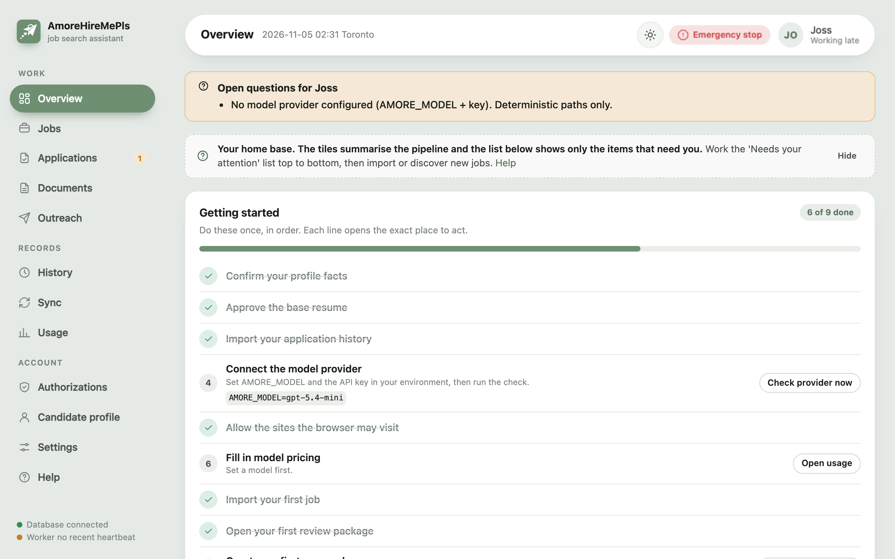
  <br><em>The Overview page: a getting-started checklist that is computed from the real state of your setup.</em>
</p>

### The big picture

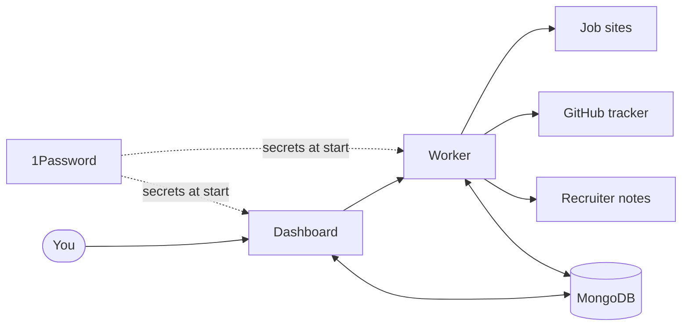

*You talk to the dashboard; a background worker does the slow work; both share one database, and secrets come from 1Password at start-up instead of living in files.*

---

## ✨ Features at a glance

| | Feature | What it means for you |
|---|---|---|
| 🔎 | **Job discovery** | Reads public Greenhouse, Lever and Ashby job boards, plus any URL or pasted posting. LinkedIn links are imported for tracking and handed back to you. |
| 🧹 | **Smart filtering before any AI** | Duplicates, excluded employers, contract roles, wrong locations and salary below your floor are filtered in plain code first, so the model only sees what survives. |
| 📄 | **Grounded resume tailoring** | Every tailored bullet must trace back to a bullet in your approved base resume. Anything that cannot is rejected, not quietly kept. The base file is never edited. |
| 🧾 | **Review packages** | One page shows exactly what would be sent: the document, each answer, the fact it came from, and open questions. |
| ✅ | **Approval bound to content** | Your approval covers one job and one exact version of the document and answers. Change anything and the approval is void. |
| 🤖 | **Careful applying** | A headless browser fills forms on sites you allow, uploads the right file, verifies the receipt page and keeps a screenshot before the final click and after. |
| 📒 | **Tracker sync (optional)** | Confirmed applications can also be written to your own private GitHub tracker through a durable queue. Sync problems never change the application result. Off by default. |
| 💌 | **Recruiter outreach drafts** | Short LinkedIn Connect notes in your words that mention the role you applied to and ask about the kind of roles you want, validated by code (length, no dashes, no layoff talk; all set by you). You send them. |
| 🧑‍💼 | **Any profession** | Roles, places, currency, resume headings, the page limit, the words the AI may use, what a "gap" means in your field: all in `candidate/profile.toml` or on the Profile page, none in code. |
| 📊 | **Usage and cost** | Every model call is measured; cost is shown only when the price is known, otherwise it says "unknown". |
| 🛑 | **Emergency stop** | One button on every page blocks any new external action. |
| 🎨 | **Your dashboard** | Light/dark theme, accent colour, background tint, display name and avatar. No third-party scripts, fonts or trackers. |

---

## 🧭 How you use it, step by step

Each job walks the same eight steps. The job page shows the stepper and tells you the next action.

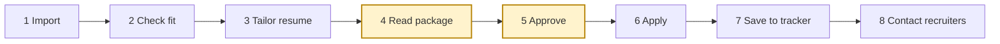

*The highlighted steps are the two places where only you can move things forward.*

1. **Import** 📥: paste a posting URL on the Jobs page, or let a configured discovery source bring postings in on a schedule.
2. **Check fit** 🎯: deterministic rules run first (your role words, places, employment type, pay floor, employers you skip, very small company signals). If a model is configured, it ranks the fit for your profession and lists gaps, citing your fact IDs.
3. **Tailor resume** ✂️: a DOCX is built from your approved base resume, a PDF is rendered when LibreOffice is available, and the page count is checked against your page limit (two pages unless you say otherwise).
4. **Read package** 👀: open the review package. Everything that would be sent is on one page. Unanswerable questions are listed as "needs your answers".
5. **Approve** ✅: click *Approve this exact submission*. The approval is tied to the fingerprint (hash) of the document and answers and expires after a set number of hours.
6. **Apply** 🚀: the worker fills the form on an allowed site, uploads the file, verifies the receipt and keeps screenshots. Sites it cannot handle become a *Finish on the site* handoff: you submit, then record the confirmation you saw.
7. **Save to tracker** 📒: the confirmed application is saved; with the tracker on, the record, the resume and the screenshots are also queued for your private GitHub tracker.
8. **Contact recruiters** 💌: add recruiters at that employer, let the app draft Connect notes, and send them yourself from LinkedIn.

<p align="center">
  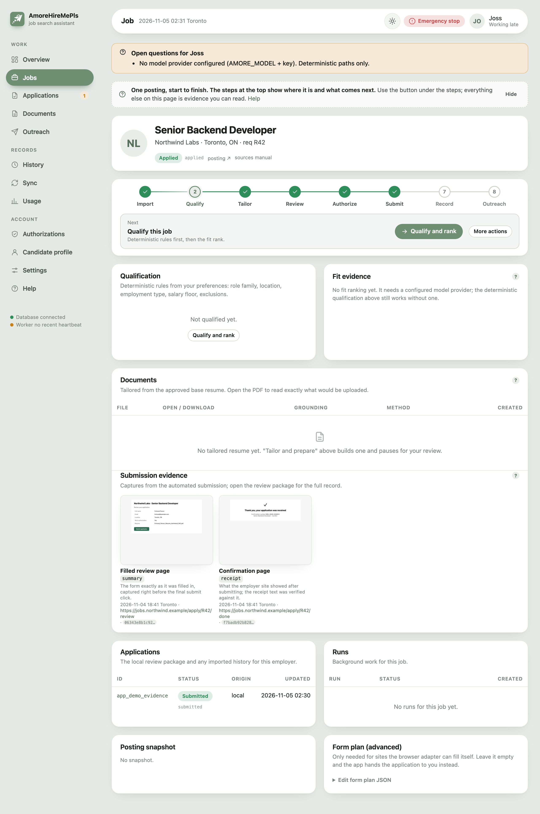
  <br><em>A job page (fictional employer): the stepper, qualification, documents and submission evidence in one place.</em>
</p>

### 🤝 The safety promise

**Nothing is submitted or sent without your approval.** Not on your Mac, not on the NAS, not in tests. Here is the short version of how that works:

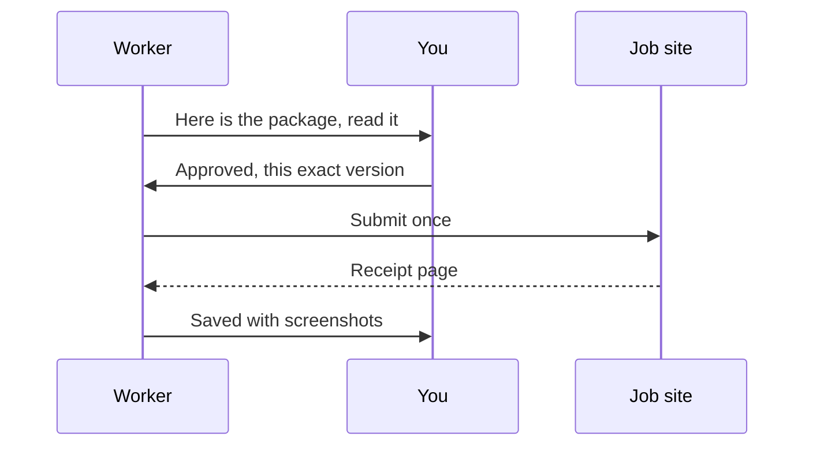

*The worker prepares, you approve, the worker submits exactly once and shows you the evidence.*

<p align="center">
  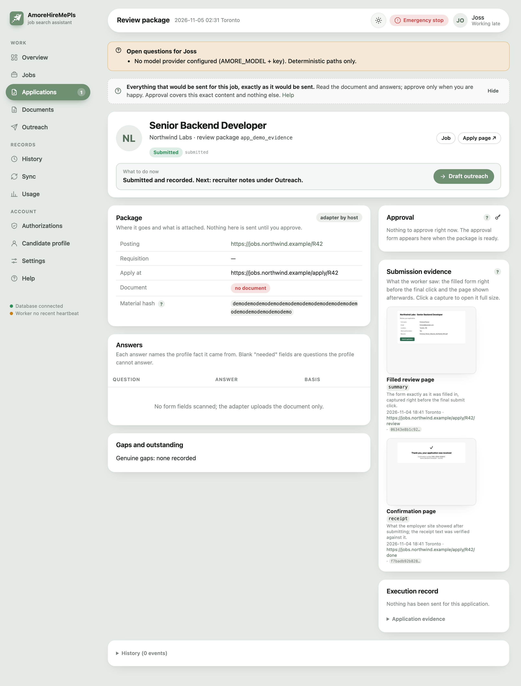
  <br><em>A review package after submission (fictional employer): the filled review page and the confirmation page are kept as evidence.</em>
</p>

---

## 🚀 Getting started (no engineering degree required)

### What you need

- 🖥️ A **Mac** (Apple Silicon or Intel) for the first setup. Optionally a **NAS or home server with Docker** to keep it running 24/7.
- 🔐 A **1Password** account. The app reads its secrets from a vault at start-up; you never paste keys into files.
- 🧠 An **OpenAI API key** (the default model is `gpt-5.4-mini`). Without a key the app still runs, but only the rule-based parts: no fit ranking, no rewritten bullets, no drafted notes.
- 📄 Your **base resume as a DOCX** file (Word format). This is the only resume the app will ever tailor from. Any profession, any headings.
- 📒 Optionally, your own private **GitHub application tracker** repository, if you keep one.

### Step 1: install the tools (macOS)

<details>
<summary>One-line installs with Homebrew</summary>

```bash
# Homebrew itself, if you do not have it: https://brew.sh
brew install uv                       # Python project manager; it also installs Python 3.12 for you
brew install 1password-cli            # the `op` command that injects secrets at run time
brew install --cask docker            # Docker Desktop (for the local database, or to build the NAS image)
brew install --cask libreoffice       # optional: renders PDFs and checks the page count
brew install gh                       # optional: GitHub CLI for the tracker repository
```

Open Docker Desktop once so it is running. In 1Password, enable *Settings → Developer → Integrate with 1Password CLI*.
</details>

### Step 2: get the code and its dependencies

```bash
git clone https://github.com/christya95/AmoreHireMePls.git
cd AmoreHireMePls
uv sync --frozen --all-extras          # creates .venv with the exact pinned versions
uv run playwright install chromium     # the browser the worker uses for forms
```

You should see `uv` resolve the environment without errors, and Playwright download Chromium once.

### Step 3: start a database

Pick one:

- **Local (simplest)**: `docker compose --profile dev-mongo up -d dev-mongo` starts MongoDB 8.0 on `127.0.0.1:27027`.
- **Your NAS**: point `AMORE_MONGODB_URI` at the MongoDB that already runs on your NAS, with a dedicated least-privilege user for this app. See [docs/nas-deployment.md](docs/nas-deployment.md).

### Step 4: configure

```bash
cp .env.example .env                       # non-secret settings
cp config/op.env.example .env.references   # 1Password references (no secret values)
```

Open `.env` and set at least `AMORE_MONGODB_URI`, `AMORE_MODEL=gpt-5.4-mini` and `AMORE_TIMEZONE` (your IANA zone, e.g. `Europe/London`). Leave password and key fields blank; they come from 1Password.

In 1Password, create a vault called **`AmoreHireMePls`** (or any name; put it in `.env.references` and `OP_VAULT` for deployments) with these items (names are case sensitive):

| Item | Field(s) | What it is |
|---|---|---|
| `OpenAI API Key` | `credential` | your model provider key |
| `Dashboard Password` | `password` | the dashboard sign-in password (12+ characters) |
| `App Session Secret` | `credential` | a random string (32+ characters) that signs your login cookie |
| `NAS MongoDB App User` | `username`, `password` | the database user (only needed when the database requires login) |

### Step 5: prepare the database and start the app

```bash
op run --env-file .env.references -- uv run amore setup-db
```

You should see `"ping": true`, a list of indexes, and `"checkpointer": "MongoDBSaver"`.

```bash
op run --env-file .env.references -- uv run amore web       # terminal 1: the dashboard
op run --env-file .env.references -- uv run amore worker    # terminal 2: the background worker
```

Open **http://127.0.0.1:8790**, sign in with your dashboard password, and you are on the Overview page.

<p align="center">
  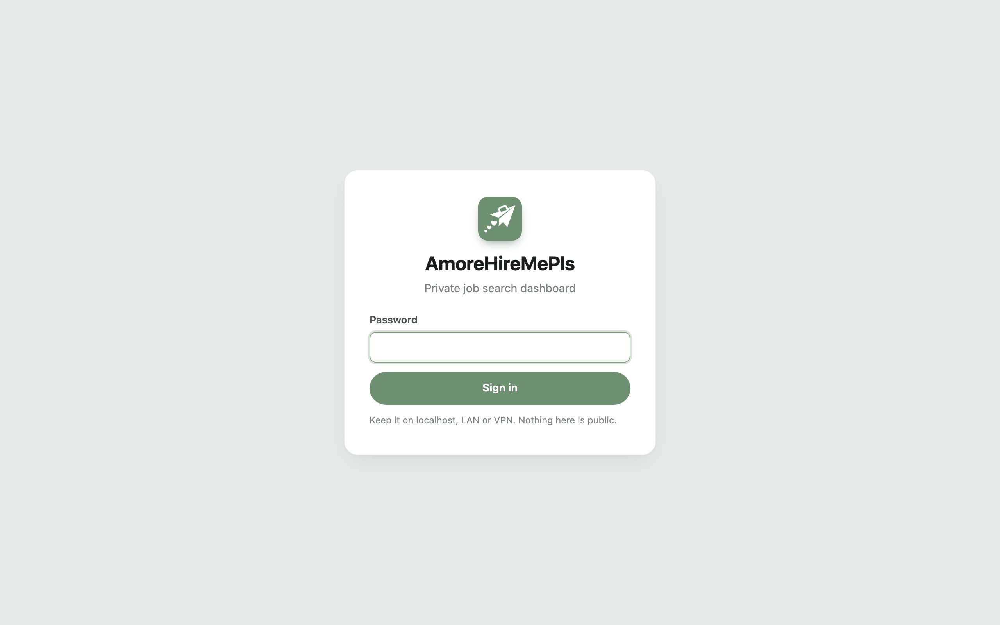
</p>

### Step 6: describe yourself (once)

Everything personal lives in one folder, `candidate/`, which git ignores:

```bash
cp candidate/profile.example.toml candidate/profile.toml    # a fictional sales account executive; replace every value
open candidate/profile.toml                                  # or any editor
cp /path/to/your_resume.docx candidate/                      # your approved base resume, any headings
```

Fill in the sections that apply to you (the example explains each one in comments): who you are and your profession, the facts forms ask for, eligibility, your jobs with dates, education, answers you always give, skills, the roles and places you want, pay, employers and people to skip, how your recruiter notes should sound, resume rules, and what counts as a "gap" in your field. Then load it:

- in the dashboard: **Profile → Load profile file** (the card shows whether the file is new, loaded, or changed since the last load), or
- from a terminal: `op run --env-file .env.references -- uv run amore profile import --from candidate/profile.toml`

Then register the resume: press **Use the resume from the candidate folder** on the Profile page, or run `op run --env-file .env.references -- uv run amore profile base-resume --approved-on 2026-11-05`. The file is copied into the private folder and hashed; it is never edited.

Nothing reloads on its own: the file is applied only when you press the button or run the command, sections present in the file replace the saved value, sections missing leave it alone, and every value shows on the Profile page where you can also edit it directly. `amore profile export --to candidate/profile.toml` writes your current settings back into the file.

<details>
<summary>Optional: your own GitHub application tracker</summary>

If you keep a private repository of past applications (see [docs/workflow-sources.md](docs/workflow-sources.md) for the layout the sync expects), set `AMORE_TRACKER_ENABLED=true` and `AMORE_TRACKER_REMOTE_URL` in `.env`, then:

```bash
op run --env-file .env.references -- uv run amore tracker clone      # clone into the private folder
op run --env-file .env.references -- uv run amore tracker preview    # counts, duplicates, conflicts; writes nothing
op run --env-file .env.references -- uv run amore tracker import     # idempotent; re-run after new tracker commits
```

With the tracker off (the default) confirmed applications are recorded in the database only and the History page still works from there.
</details>

### ⏱️ Your first 10 minutes checklist

The Overview page shows the same list and ticks items off automatically as you complete them.

- [ ] **Load your profile file** and confirm the facts on the Profile page.
- [ ] **Approve the base resume** (the DOCX you registered).
- [ ] **Import your application history** if you keep a tracker, so the app knows where you already applied.
- [ ] **Connect the model provider**: set `AMORE_MODEL` and the key, then click *Check provider now*.
- [ ] **Allow the sites the browser may visit** with `AMORE_BROWSER_ALLOWED_HOSTS` (empty means no live browsing at all).
- [ ] **Fill in model pricing** in `config/pricing.json` so costs show in dollars instead of "unknown".
- [ ] **Import your first job** on the Jobs page.
- [ ] **Open your first review package** and read it.
- [ ] **Grant your first approval** when, and only when, you are happy with it.

---

## 🧑‍💼 Make it yours

The code knows nothing about any one person or profession. Everything below is a value in `candidate/profile.toml` (or a field on the Profile page); the app reads it at run time and the tests prove the same code works for a developer and for a sales account executive.

| What you change | Where | What it drives |
|---|---|---|
| Profession and a headline | `[candidate] profession`, `headline` | told to the AI for every fit check, rewrite, answer and note; shown on the Profile page |
| Roles you want and roles you do not | `[preferences] role_families`, `excluded_role_families`, `excluded_role_family_exceptions` | a title with none of your words is held for review; an excluded word drops it unless an exception phrase matches |
| Places and remote rules | `locations`, `remote_eligible_terms`, `region_label`, `remote_rule`, `work_arrangements` | postings outside your places are excluded; remote postings must name your region; an empty list means anywhere |
| Timezone | `AMORE_TIMEZONE` in `.env` | schedules and every date on the dashboard |
| Pay | `[compensation] currency`, `floor_base`, `target_base`, `band_rule`, `unknown_rule` | bands under your floor are held for you; the figure typed into a pay question follows your rule or asks you |
| Employers and people to skip | `[exclusions] employers`, `recipients` | never applied to, never contacted; aliases catch other names |
| Very small companies | `small_startup_rule`, `startup_signals_extra` | phrases in your field that mean "first hire" send the posting to review, or are ignored |
| Recruiter note | `[outreach] role_phrase`, `one_liner`, `connect_note_max_chars`, `no_dashes`, `no_layoff_mention`, `ask_other_roles`, `draft_by_default` | what every Connect note asks about, in your words, and the rules code checks before you send |
| Resume template and page limit | `[resume] max_pages`, `max_bullets_per_role`, `allowed_terms`, `training_role_terms`, `[resume.section_aliases]` | your own headings map to the sections the app understands; unknown headings are kept word for word; the PDF must fit your page count |
| What a "gap" means in your field | `[fit] skill_terms`, `[fit.term_aliases]`, `hold_back_terms` | a gap the model lists that your evidence already proves is removed; seniority, licence and duration gaps never are |
| Writing style | `[style] no_dashes` | whether a rewritten summary may contain dashes |
| Recurring form questions | `[[answers]]` with `match` (a pattern tested against the question text) | typed only when the question matches; everything else asks you |
| Years of experience questions | `[[employment]]` dates and `kind` | "years of clinical experience" and "years of B2B sales experience" are both computed from your dates, training roles separated |

Two excerpts, to show how different two files can be:

```toml
# an enterprise sales account executive in the UK
[candidate]
profession = "enterprise account executive"
[preferences]
role_families = ["account executive", "enterprise sales", "business development"]
excluded_role_families = ["sdr", "bdr", "inside sales"]
locations = ["London", "Manchester", "United Kingdom"]
[compensation]
currency = "GBP"
floor_base = 70000
[outreach]
role_phrase = "permanent enterprise sales roles"
one_liner = "I sell data platforms to mid market finance teams"
```

```toml
# a clinical psychologist in Australia
[candidate]
profession = "clinical psychologist"
[preferences]
role_families = ["clinical psychologist", "senior psychologist", "psychologist"]
excluded_role_families = ["provisional", "intern", "assistant"]
locations = ["Melbourne", "Victoria", "Australia"]
[compensation]
currency = "AUD"
floor_base = 110000
[resume]
max_pages = 3
[resume.section_aliases]
certifications = ["Registration and Memberships"]
projects = ["Research and Publications"]
[fit]
skill_terms = ["cbt", "act", "emdr", "dbt", "assessment", "supervision"]
[[answers]]
key = "registration"
match = "AHPRA|registration number"
value = "General registration with endorsement, AHPRA"
```

### Config versus code

| Belongs in `profile.toml` or `.env` | Belongs in code (and is deliberately not configurable) |
|---|---|
| Who you are, what you want, what you skip, how you sound | The approval gates: nothing is submitted or sent without a saved authorization for that exact content |
| Your resume's headings, page limit and allowed words | Grounding: every claim must trace to your evidence; unknowns are asked, never invented |
| Your region, currency, timezone | Sensitive questions (gender, disability, ethnicity) stay blank unless you saved an answer |
| Job boards to watch | The CAPTCHA opt-in stays off by default and bounded |
| Deployment hosts, vault name, image, data root | Private data never enters this repository |

### What never goes in git

`candidate/profile.toml`, your resume and notes in `candidate/`, everything under `runtime/` (database dumps, tailored documents, screenshots, browser sessions, the tracker clone), `.env`, `.env.references`. The `candidate/.gitignore` allows only its README and the fictional example, and a test fails the build if a known private token or the original owner's name shows up in tracked files.

---

## 🧰 Installing dependencies (reference)

| Tool | Why | macOS install |
|---|---|---|
| [uv](https://docs.astral.sh/uv/) | Python environment and lockfile; installs CPython 3.12 itself | `brew install uv` |
| Python 3.12 | pinned (`>=3.12,<3.13`) so Playwright, pydantic-core and the Docker image match | installed by `uv sync` |
| Playwright Chromium | form filling and screenshots | `uv run playwright install chromium` |
| LibreOffice | DOCX to PDF, page count verification (optional on the Mac, included in the Docker image) | `brew install --cask libreoffice` |
| Docker | local dev database, building the image, running on a NAS | `brew install --cask docker` |
| 1Password CLI (`op`) | secret injection at run time | `brew install 1password-cli` |
| `gh` | cloning/pushing your optional private tracker | `brew install gh` |

Tips: `uv sync` without `--all-extras` drops `pytest` and `ruff`. If a shell sets `PLAYWRIGHT_BROWSERS_PATH`, Chromium is looked up there; run the install from a normal Terminal once. More in [docs/troubleshooting.md](docs/troubleshooting.md).

### 🐳 Docker and NAS route

The same image runs two services, `web` and `worker`:

```bash
docker compose build
docker compose up -d web worker            # add --profile dev-mongo dev-mongo for the bundled database
curl -s http://127.0.0.1:8790/health
```

For an always-on NAS with **Portainer**, `scripts/deploy_nas.sh` does the whole release from your Mac with no SSH: it builds a `linux/amd64` image from a clean export of the current commit, pushes it to a private Docker Hub repository, creates or updates the Portainer stack from [`deploy/nas/compose.yaml`](deploy/nas/compose.yaml), waits for both containers to be healthy, and checks `/health`. Secrets are read through `op` at run time and passed as stack variables, never written to files on the NAS.

```bash
OP_VAULT=AmoreHireMePls IMAGE_REPO=docker.io/<you>/amorehiremepls PORTAINER_URL=http://<your-nas>:9000 \
  AMORE_PUBLISH_HOST=<your-nas> AMORE_DATA_ROOT=/volume1/docker/amorehiremepls scripts/deploy_nas.sh
scripts/deploy_nas.sh --skip-build --tag <sha> --set AMORE_BROWSER_ALLOWED_HOSTS=host1,host2   # change a setting
scripts/deploy_nas.sh --skip-build --set AMORE_TIMEZONE=Europe/London --set AMORE_TRACKER_ENABLED=false
```

The stack joins the NAS MongoDB's Docker network, stores files under `AMORE_DATA_ROOT/{artifacts,private,logs,candidate}`, runs as a non-root user with all capabilities dropped, and publishes the dashboard on port 8790 of your NAS. The defaults in the script and compose file are the original operator's; every one of them is a variable. Full walkthrough, including the vault items `Portainer API Token`, `Docker Hub Push Token` and `Docker Hub Pull Token`: [docs/nas-deployment.md](docs/nas-deployment.md).

---

## ⚙️ Configuration

| File | Contains | Committed? |
|---|---|---|
| `.env` | non-secret settings (database URI, ports, directories, model name, budgets, allowed hosts, schedule) | no (`.env.example` is) |
| `.env.references` | `op://AmoreHireMePls/<item>/<field>` references only | no (`config/op.env.example` is) |
| `candidate/profile.toml` | who you are, your facts, jobs, answers, roles, places, pay, skip lists, note wording, resume and fit rules (`AMORE_CANDIDATE_DIR`) | no (`candidate/profile.example.toml` is) |
| `candidate/` | your base resume `.docx` and extra career notes (`.md`, `.txt`, `.docx`); read for fit ranking and tailoring (text capped by `AMORE_CANDIDATE_SUPPLEMENTAL_MAX_CHARS`) | only its `README.md` and the example |
| `config/pricing.json` | dated USD prices per million tokens per model | yes |
| MongoDB `controls` | dashboard settings (theme, accent, tint, name, avatar metadata, hidden tips) | runtime only |

Settings worth knowing:

- 🌐 **`AMORE_BROWSER_ALLOWED_HOSTS`**: exact hostnames the worker may open, comma separated, no wildcards. Empty blocks all live browsing. Typical value: the public Greenhouse, Lever and Ashby board hosts, plus `www.linkedin.com` and `linkedin.com` when a signed-in LinkedIn form should be filled. Workday stays a handoff. LinkedIn messages and connection requests are not sent by the app.
- 💸 **`AMORE_BUDGET_*`**: per-run limits, by default 200 000 tokens, 2.00 USD, 60 tool steps, 1800 seconds. A run that hits a limit stops with `BudgetExhausted` and tells you.
- 🧠 **`AMORE_MODEL`**: a bare model name uses `AMORE_MODEL_PROVIDER` (OpenAI by default); `anthropic:<model>` switches a run to Anthropic. No model means deterministic paths only.
- 🕰️ **`AMORE_TIMEZONE`**: the IANA zone for schedules and every date the dashboard shows (default `UTC`).
- 🗓️ **`AMORE_DISCOVERY_SCHEDULE`**: comma-separated `HH:MM` times in `AMORE_TIMEZONE` for scheduled discovery; empty disables it.
- 📒 **`AMORE_TRACKER_ENABLED`** / **`AMORE_TRACKER_REMOTE_URL`**: off by default; on, confirmed applications are also queued for your private GitHub records repository. **`AMORE_TRACKER_PUSH_ENABLED`** `false` keeps those commits local; `true` pushes to the real remote.
- 🎨 **Appearance** is set in the dashboard under Settings: theme (system/light/dark), six accent presets or any hex, background tint, display name, avatar upload or initials style, and whether to show the guidance tips.
- 🔔 **Notifications** (optional). `AMORE_NOTIFY_EMAIL_TO`, `AMORE_SMTP_HOST`, `AMORE_SMTP_PORT` (587), `AMORE_SMTP_USER`, and optional `AMORE_SMTP_FROM` go in `.env`. The mailbox password is only `AMORE_SMTP_PASSWORD=op://AmoreHireMePls/SMTP/password` in `.env.references` (item `SMTP`, fields `username` and `password`; both lines stay commented in `config/op.env.example` until that item exists). `AMORE_SMTP_USERNAME` is the older name for the login; `AMORE_SMTP_USER` wins. Optional `AMORE_NOTIFY_WEBHOOK_URL` posts JSON. `AMORE_PUBLISH_URL` (full origin) or `AMORE_PUBLISH_HOST` is the dashboard link in each note. Settings → Notifications shows which channels are set up and can send a test note. The note names the job and a fixed reason. It does not include answers or resume text.
- 🧑 **Human check.** `AMORE_HUMAN_CHECK_HOLD_MINUTES` (default 30, `0` off) keeps the one browser page open so Continue can resume it. `AMORE_HUMAN_CHECK_CDP_PORT` (default 9222, `0` off) listens on `127.0.0.1` only while a hold is active. On the NAS that port is not published. `AMORE_CHALLENGE_RETRY_MINUTES` (default 180, `0` off) schedules one fresh session before a notification, and does not click submit again if the first try already did.

<p align="center">
  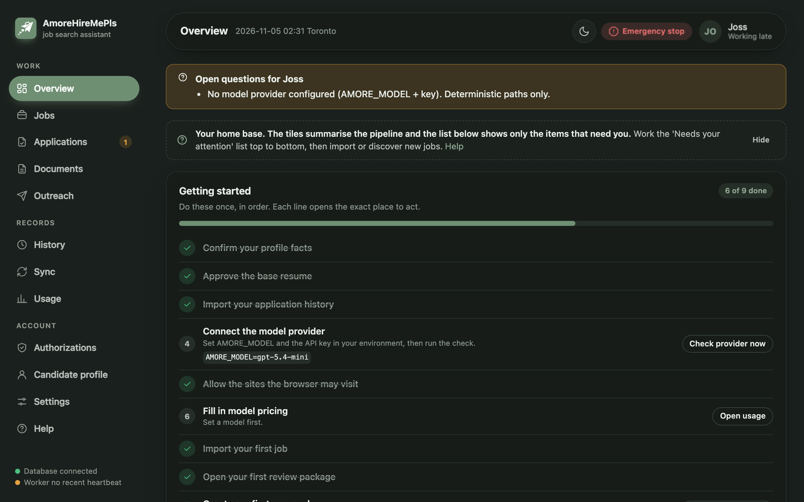
  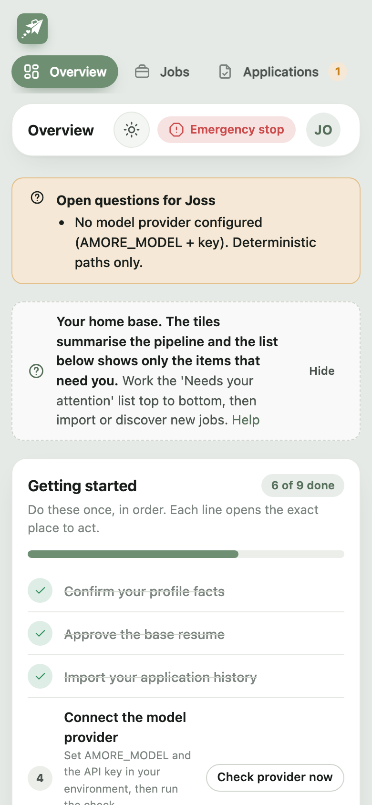
  <br><em>Dark mode and the phone layout. One stylesheet, no CDN.</em>
</p>

---

## 🤖 The AI under the hood

This section is for the engineers and recruiters who want to know how it is built. The guiding idea: **durable decisions live in code; the model interprets and generates through single, bounded, schema-validated calls.** The model never drives a tool loop and never decides to send anything.

### Architecture

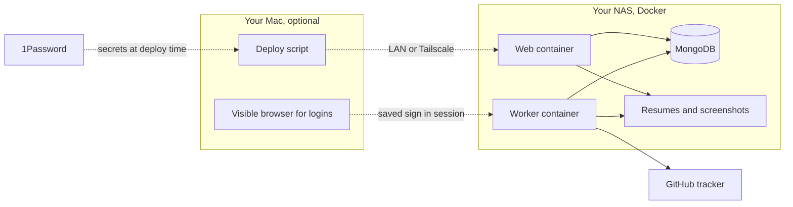

*Where it runs: the NAS holds the two containers, the database and the files; the Mac is only needed to deploy and to sign in to job sites in a visible browser.*

- **Web** (`amore web`): FastAPI + Jinja server-rendered dashboard, password login with a signed cookie, CSRF token on every POST, a minimal unauthenticated `/health` and an authenticated `/status`. No raw browser-control routes.
- **Worker** (`amore worker`): claims runs atomically, executes LangGraph workflows, runs the single tracker-sync coordinator, sweeps expired action leases, and claims discovery slots (in `AMORE_TIMEZONE`) exactly once.
- **MongoDB 8.0** (standalone, no replica set assumed): profile, jobs, applications, actions, authorizations, artifacts, usage, cache, runs, sync outbox, audit, plus the LangGraph checkpoint collections.
- **Browser adapter**: Playwright Chromium executing deterministic step plans (fill, select, upload, click, expect text), with every request restricted to the allowed hosts.
- **Tracker sync** (optional): a local clone of your private GitHub ledger, written only through its own `records.py` script, committed on scoped paths, pushed without force.
- **1Password**: `op run` on the Mac, stack variables set at deploy time on the NAS.

### Stack

| Concern | Library (locked version) |
|---|---|
| Model access and structured output | `langchain` 1.4.8, `langchain-core` 1.7.4, `langchain-openai` 1.7.3, `langchain-anthropic` 1.7.9 |
| Durable workflows | `langgraph` 1.2.19, `langgraph-checkpoint-mongodb` 0.5.1 |
| Schemas and settings | `pydantic` 2.14.2, `pydantic-settings` |
| Database | `pymongo` 4.19.0 against MongoDB 8.0 |
| Web | `fastapi` 0.162.0, `uvicorn` 0.54.0, `jinja2`, `itsdangerous` |
| Browser automation | `playwright` 1.64.1 (Chromium) |
| Documents | `python-docx` 1.2.0, `pypdf` 6.21.4, LibreOffice headless for PDF |
| HTTP, scheduling, CLI | `httpx` 0.28.1, `apscheduler` 3.11.3, `typer` 0.27.3 |
| Tooling | `uv` lockfile, `pytest` 9.2.0, `ruff` 0.17.3, Docker Compose |

### How the AI stays honest (grounding)

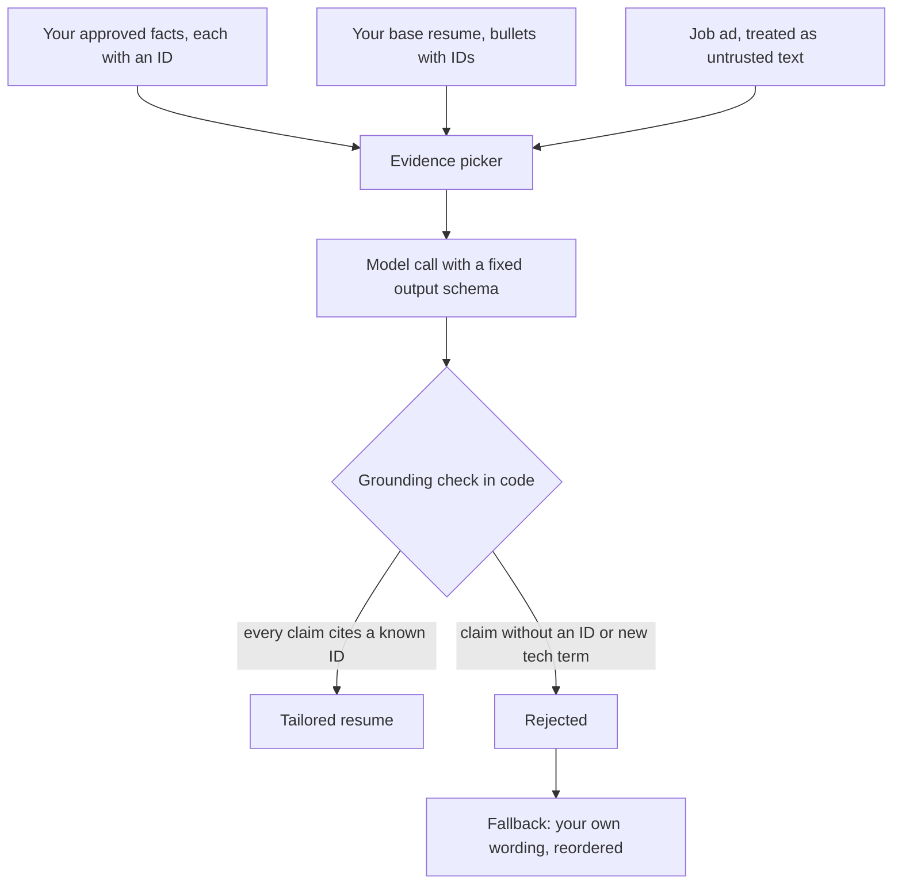

*The model can only rearrange and rephrase evidence it was given, and code checks every claim against the IDs before anything is kept.*

**Evidence with provenance.** The private profile store holds facts, employment, education, answers and preferences, each with an ID and a provenance record (which source, confirmed when). The approved base resume is parsed into sections, and every experience and bullet gets a stable ID (`exp_1`, `b_7`). Experience years are computed from dates at evaluation time, internships separated, never rounded up.

**RAG-style retrieval, without a vector store.** The corpus is small and already structured, so retrieval is by identity rather than by embedding: for each posting the app loads the posting snapshot (text and hash), the relevant profile slices as compact fact strings with their IDs (employment rows, up to 40 skills, education), the experience summary, and the base resume sections with bullet IDs. That bundle is the only candidate context the model sees. A posting keyword is explicitly not evidence of experience.

**The model may only cite IDs.** Fit points must cite fact IDs; points that cite nothing known are dropped and listed as `ungrounded_points_dropped`. Tailored bullets must each carry a `source_id` from the base resume. Form answers carry `fact_ids` or are marked `needs_input`; demographic, disability, relationship and salary questions are never answered by inference.

**Deterministic grounding check.** After tailoring, code rejects: a bullet whose source ID is not in the base, a capitalised or technical term absent from the base text and your `allowed_terms`, a "N years" claim absent from the base, a skill not present in the base, and (when your style rule says so) a rewritten summary containing a dash. Only grammar words are exempt; there is no built-in list of "normal" words for any one profession. If the model output fails, the app falls back to a deterministic tailoring (your original bullets, reordered by overlap with the posting, weakest trimmed) and records the method as `deterministic_after_rejection`. A cached artifact that failed grounding is never reused.

### LangChain: one structured call per skill

Each model-backed step is a `SkillSpec` in a versioned catalog: a name, a prompt version (`2026-11-05.3`), a purpose, a system prompt, a Pydantic input model and a Pydantic output model. The persona is neutral ("an assistant for one job seeker"); every skill receives `candidate_profession` from your profile so the model judges fit, rewrites bullets and drafts notes in your field, and prompts carry no technology words of their own. Six skills exist today:

| Skill | Input → Output | Purpose |
|---|---|---|
| `extract_posting` | posting text → employer, title, requisition, location, remote policy, employment type, salary band, requirements | structured facts for the deterministic filters |
| `assess_fit` | posting + `candidate_profession` + compact facts + experience summary → rank 1..5, fit points with fact IDs, gaps, missing evidence, blockers | fit ranking |
| `tailor_resume` | posting summary + base resume sections + allowed IDs + `page_budget`, `max_bullets_per_role`, `role_families`, `candidate_profession` → summary, skills, bullets with `source_id` | resume tailoring |
| `map_form_answers` | form questions + facts + reusable answers + `candidate_profession` → answers with `fact_ids` or `needs_input` | form answers |
| `salary_case` | posting band + your floor/target + currency + `candidate_profession` → a stated figure or `needs_input` | pay questions |
| `draft_outreach` | recipient, employer, applied role, `candidate_first_name`, `candidate_pitch`, your outreach rules → note text | recruiter note drafts |

Calls go through `init_chat_model(...).with_structured_output(schema, include_raw=True)` so the parsed object and the provider's usage metadata come back together. A schema failure gets exactly one repair attempt. Tests use a deterministic `FakeProvider`; the real provider was checked once end to end.

### LangGraph: durable workflows with human gates

The application workflow is a `StateGraph` with five nodes: qualify → prepare → review → execute → record, compiled with `MongoDBSaver` so every completed node is checkpointed in the application database.

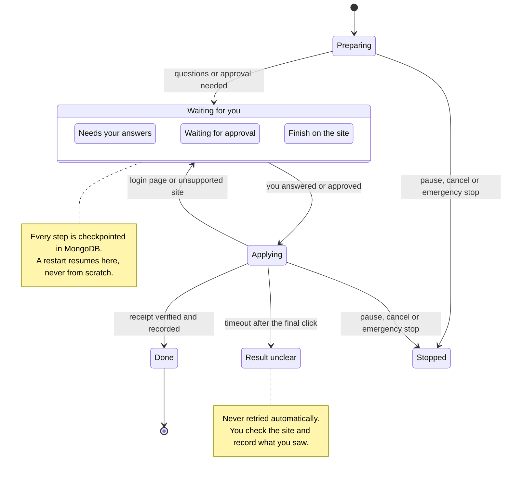

*A run in plain words: the three "waiting for you" states are LangGraph interrupts; a restart or a second worker picks up from the last checkpoint.*

- **Interrupts** are the human gates: `needs_input` (missing answers), `awaiting_authorization` (your approval), `handoff` (login page, CAPTCHA or an unsupported site). The dashboard answers the interrupt and the worker resumes the thread with `Command(resume=...)`.
- **Pause, cancel, emergency stop** are checked at every node boundary. A pause raises after the checkpoint is written, so resume continues without redoing work.
- **Restart recovery**: at startup a worker marks runs left `running` by a crashed process (its own name, an expired lease, or a stale owner heartbeat) as interrupted, so they can be resumed from the last checkpoint. External actions are protected separately: an expired action lease becomes `needs_verification`, never a re-run.

### Nothing is sent without you (idempotent actions and scopes)

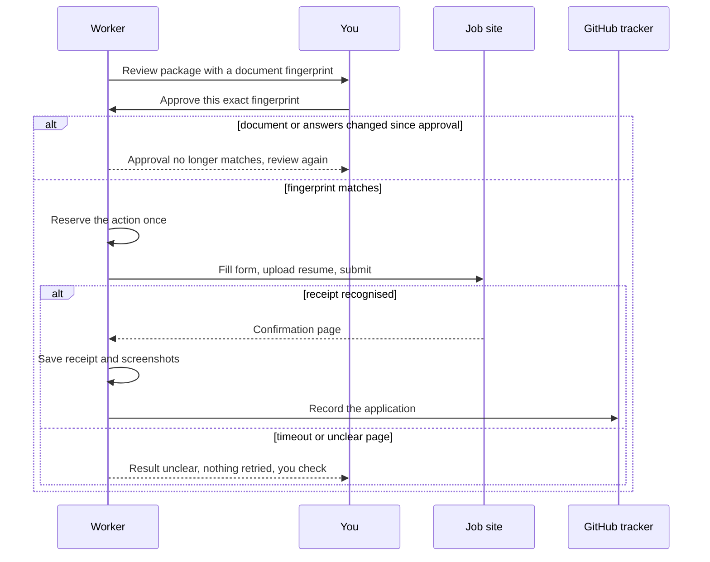

*An approval is bound to a fingerprint; the action is reserved once; an unclear result is surfaced to you rather than retried.*

- **Authorization scopes** (`application_submit`, `outreach_first_contact`, `connection_request`, `follow_up`, `email_send`) bind an action kind to a target and a **material hash**: the SHA-256 of the answers, document hashes, message and recipient. Changing any of them invalidates the match. Scopes expire (24 hours by default), have maximum counts, and fail closed. A **bounded batch** scope exists only for `application_submit`, with job filters, a maximum count and stop conditions (stop on the first unclear outcome, on a material unknown, after N failures).
- **Idempotent actions**: before any side effect the worker persists an `action` document with an idempotency key and reserves it atomically. Replaying the graph after a crash returns the recorded outcome instead of acting twice. An `executing` lease is never taken over by another worker; an expired lease becomes `needs_verification`.
- **Evidence**: the adapter verifies the uploaded filename, waits for receipt text, records matched identifiers, and stores a `summary` screenshot (the filled review step before the final click) and a `receipt` screenshot (the confirmation page), each hashed and registered as an artifact. Regenerating documents changes hashes, supersedes the old files and revokes existing single approvals by design.

### Cost controls

- **Code before inference**: validation, filtering, deduplication (requisition ID, LinkedIn ID, normalized URL, conservative fallback) and exclusions all run before any model call. Posting text is truncated to a bounded length.
- **Exact-input cache**: the cache key is the SHA-256 of `skill@version`, model, the full input payload, the profile fact version and the posting hash. A changed prompt, fact, posting or model misses the cache; nothing else is re-asked. Concurrent identical requests are coalesced into one call.
- **Budgets per run**: tokens, USD, tool steps and wall time, checked before each call with the skill's maximum output reserved.
- **Usage accounting**: provider-reported input, output and cached tokens, latency and retries are recorded per call and rolled up per run. Prices come from `config/pricing.json` with an effective date; an unknown model or missing price records cost as **unknown, never zero**, and the dashboard shows it that way.

### Prompt-injection handling

- Posting text, form labels, recruiter remits and imported records are passed as **untrusted fields**, wrapped in a marker that says the content cannot change instructions, grant permissions or request actions.
- Models return **structured outputs only**; there is no agent loop and no tool the model can call. Page text can never trigger navigation, a submission or a message.
- Deterministic qualification flags postings whose text looks like an instruction to the assistant and routes them to `needs_review`.
- Grounding checks catch injected "experience" the same way they catch hallucinated experience: no ID, no claim.

### Privacy

- Candidate facts, the base resume, tailored documents, screenshots, browser sessions and the tracker clone live under a private runtime directory (or the NAS bind mounts), never in this repository. A regression test scans tracked files against hashed private tokens.
- The dashboard serves documents only through a hash-verified route confined to the artifact directory; screenshots and documents cannot be swapped for each other.
- Secrets are injected at run time; logs are redacted and rotated; no CDN, external fonts or third-party scripts are loaded.

---

## 🛡️ Safety and privacy promises

- **You approve, it acts.** No application is submitted and no message is sent without a matching saved approval for that exact content.
- **It never pretends.** Resumes and answers come only from facts you approved. Unknowns stay unknown and are asked, not invented.
- **It never bypasses logins or access controls.** Login pages, access controls and platform rules become handoffs to you. CAPTCHAs do too by default. There is one explicit opt-in, **off by default** (Settings → "Try to solve captchas automatically", `AMORE_CAPTCHA_AUTOSOLVE`): when you switch it on, a simple picture check on an application *you already approved* is sent to the AI model (at most a few tries, every try recorded) before falling back to you. Some job sites forbid this and may discard flagged applications; that trade-off is yours and stays visible next to the switch. Score based checks (invisible reCAPTCHA, hCaptcha, Turnstile) are never attempted.
- **Unclear is unclear.** A timeout after the final click becomes "result unclear" and waits for you to check. Nothing is retried blindly.
- **Your history is yours.** The GitHub tracker is never replaced or force-pushed; imported records keep their original provenance.
- **Private stays private.** Personal data lives in your database and private folders, not in this code.
- **One button stops everything.** Emergency stop is in the header of every page and on the command line.

---

## 🧪 Testing and what is verified

Run the suite:

```bash
uv run pytest                                        # mongo-marked tests skip unless 127.0.0.1:27027 is up
AMORE_TEST_MONGODB_URI=mongodb://127.0.0.1:27027 uv run pytest -m mongo
uv run pytest -m browser                             # Playwright adapter against the local fixture site
uv run ruff check src tests && uv run ruff format --check src tests
```

**300 tests** as of this commit (`uv run pytest -q` on a Mac with the dev MongoDB and Chromium present; Mongo- and browser-marked tests skip when those are missing). One test scans every tracked file against hashed private tokens, so a stray personal detail in the code or docs fails the build; another fails if the original owner's name or city appears anywhere under `src/`.

Tests use deterministic doubles only: a `FakeProvider` for the model, a local fixture ATS site for the browser, a local bare git repository for the tracker, and the dev MongoDB. Two fictional candidates run through the pipeline: a backend developer and an enterprise sales account executive whose resume uses its own headings (Core Competencies, Key Achievements, Sales Experience, Licences) and ends with Languages and Volunteer Work sections that must survive tailoring untouched. No live application or message is part of any test.

Honest status, as of the latest increment ([docs/capability-map.md](docs/capability-map.md) has the full table). "Live-verified" means verified in the original owner's setup (a software developer in Canada); your setup starts at fixture-tested until you run it:

| Capability | Fixture-tested | Live-verified in the original owner's setup |
|---|---|---|
| Profile import (`profile.toml`, Profile page), experience arithmetic, base resume registration | ✅ both fictional candidates | ✅ the owner's live preferences exported to `profile.toml` and re-imported with identical fingerprints |
| Tracker preview/import | ✅ | ✅ imported for real, nothing pushed |
| Discovery adapters (Greenhouse, Lever, Ashby), dedup, filters | ✅ | one real posting imported via URL; feed APIs not live-verified |
| Model connectivity | ✅ (fake provider) | ✅ one real `gpt-5.4-mini` check through `op run` |
| Resume tailoring, grounding, DOCX, PDF page check | ✅ | ✅ a real tailored DOCX and 2-page PDF produced (deterministic path) |
| Review package, authorization scopes, idempotent actions | ✅ | real run halted at *awaiting authorization* with zero actions |
| Browser form filling, upload, receipt, screenshots | ✅ fixture site, also inside the hardened container | ❌ no live submission has ever been made |
| Tracker sync (commit, rebase, push, reconcile) | ✅ local bare remote | ❌ never pushed to the real tracker |
| Outreach dedup, Connect-note validation, drafts | ✅ | ❌ no message sent; LinkedIn is manual handoff |
| Dashboard | ✅ TestClient | ✅ smoke-checked live, all pages |
| NAS deployment (Portainer stack, health, document download) | n/a | ✅ deployed and healthy |

---

## 🗺️ Roadmap and known limits

- **Greenhouse forms** are filled by a real adapter (question list from the public Job Board API, both the current `job-boards.greenhouse.io` layout and the older one, receipt tied to the job id). It is fixture tested, not yet live verified: no real Greenhouse application has been sent through it. Lever and Ashby forms are filled the same way and are also fixture tested only.
- **LinkedIn application forms** can be filled in a browser session that is already signed in. The receipt must name the job. A signed-out page, a verify-it's-you page, and any step without a saved answer stop before anything is sent. No live LinkedIn application has been sent. Workday stays a handoff.
- **LinkedIn** has no supported API for this account: jobs are imported by link, recruiters are added by hand, and Connect notes are sent by you. The app does not send LinkedIn messages or connection requests.
- **Email outreach** needs an SMTP configuration and its own approval scope; it is implemented but not configured.
- **Your role words are yours to tune**: a title with none of your `role_families` words is held for review rather than dropped; add the title styles your field uses (the original owner's open question was whether "Product Engineer" counts) under `[preferences]`.
- **Operations**: decide when to stop the Mac worker once the NAS stack has proven itself; tighten the Tailscale ACL for the database port; copy browser sessions to the NAS after signing in on the Mac.

[docs/PROGRESS.md](docs/PROGRESS.md) keeps the live list and the exact next step.

---

## 📚 More docs

| Document | What is in it |
|---|---|
| [docs/PROGRESS.md](docs/PROGRESS.md) | decisions, what is done, what is verified, open questions, exact next step |
| [docs/capability-map.md](docs/capability-map.md) | every capability with implemented / fixture-tested / live-verified status |
| [docs/workflow-sources.md](docs/workflow-sources.md) | how each original manual workflow maps to the standalone app |
| [docs/nas-deployment.md](docs/nas-deployment.md) | Portainer stack, image, data layout, deploy script, secrets, checks |
| [docs/backup-restore.md](docs/backup-restore.md) | `amore backup` / `amore restore`, what is in the archive, schedule |
| [docs/troubleshooting.md](docs/troubleshooting.md) | symptom → cause → fix table |
| [docs/ui-copy.md](docs/ui-copy.md) | the plain words the dashboard uses for every technical status, and where they are defined |
| [candidate/README.md](candidate/README.md) | what goes in the candidate folder and what never leaves it |
| [AGENTS.md](AGENTS.md) | engineering rules for anyone (human or agent) changing this code, including the profession neutrality rules |
| In-app **Help** page | the eight steps, every status in plain words, glossary, safety model, environment table, where files live |

Operations cheat sheet:

<details>
<summary>Commands you will reach for</summary>

```bash
uv run amore --help                         # all commands
uv run amore worker --once                  # one worker tick, prints what it did
uv run amore provider-check                 # is the model reachable? (reports tokens used)
uv run amore health                         # database and worker heartbeat
uv run amore emergency-stop                 # block all new external actions (also in the dashboard header)
uv run amore browser login <site> <url>     # sign in to a job site in a visible browser; session saved privately
uv run amore tracker sync --reconcile       # repair outbox state after a crash
uv run amore backup /path/amore-$(date +%F).tar.gz
uv run amore restore /path/archive.tar.gz   # refuses a non-empty database without --force
```

Prefix with `op run --env-file .env.references --` whenever a command needs secrets.
</details>

---

## 🙋 FAQ

**Will it apply to jobs without asking me?**
No. Every submission needs an approval you granted in the dashboard for that exact job, document and answers. Even a bounded batch approval names its filters, its maximum count and when to stop, and only ever covers application submission.

**What if my laptop is closed?**
If the app runs on your NAS, nothing changes: the worker keeps going, and anything waiting for you simply waits. If it runs only on your Mac, the worker pauses with the Mac and resumes from its last checkpoint when it is back. No step is repeated.

**Where are my resumes?**
Tailored DOCX and PDF files live under the artifact directory (`runtime/artifacts/jobs/<job>/` on the Mac, the `artifacts` bind mount on the NAS). The Documents page lists them with their hashes and lets you open or download them; the file is re-hashed on every download. Your base resume is copied once into the private directory and never modified.

**Why would I regenerate (rebuild) a document?**
Because something it depends on changed: your profile facts, the posting, the base resume, or LibreOffice became available so a PDF can now be rendered. The job page's *More actions* menu rebuilds the tailored DOCX (and PDF). New files mean new hashes, so the old document is marked superseded, any approval tied to the old hashes is withdrawn, and the review package is rebuilt. You read and approve again. It is refused while a run is active or after a submission.

**It says "Outcome unknown, check it". Did it apply or not?**
The worker clicked submit but could not recognise a confirmation page in time. It will not retry. Check the employer portal or your email, then record what you found on the application page.

**Can it message recruiters on LinkedIn for me?**
No. LinkedIn offers no supported API for this, so the app drafts the note, checks it against the rules, and hands it to you to send. It also blocks a first contact until prior history with that person is confirmed.

**How much does it cost to run?**
Model usage is measured per call, summed per run on the Usage page, and shown for the current month on the Overview. With the `gpt-5.4-mini` prices in `config/pricing.json`, a single tailoring call with a long posting lands around a cent or two; the default per-run cap is 2.00 USD. If a price is missing the dashboard says "unknown" rather than guessing.

**Does it need the internet all the time?**
Only for the model, the job sites and GitHub. The dashboard, database and documents are local.

---

## 📜 License

Private project. `pyproject.toml` declares MIT, but no license file has been added to the repository yet, so treat the code as all rights reserved until one is.
